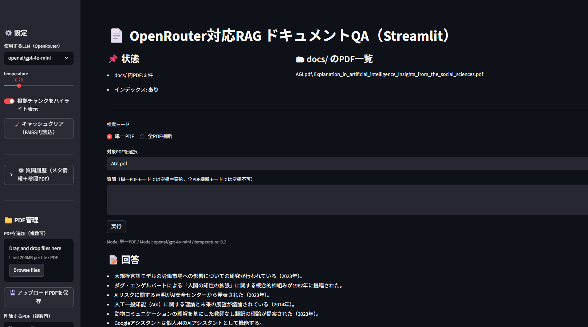

# 📄 RAG ドキュメント QA アプリ

[](https://github.com/Cherie01234/rag-doc-qa/actions/workflows/ci.yml)

## 概要

| 項目 | 内容 |
|---|---|
| 解く課題 | 手元のPDF・テキストに自然言語で質問し、回答と、その根拠になった文書の箇所をあわせて得る。LLMの回答が文書のどこに基づくかを、利用者が自分で確かめられるようにする |
| 手法 | LangChainで文書を分割（800文字・重なり100文字）→ Sentence-Transformers（`all-MiniLM-L6-v2`）で埋め込み → FAISSで質問に近いチャンクを検索 → LangChain経由のLLM（OpenRouterの DeepSeek / Grok / GPT-4o mini を画面で切替）で回答を生成。根拠チャンクのハイライト表示と、複数PDFを横断したときの文書ごとの参照数の表示に対応 |
| 評価 | 自作の日本語評価セット（架空の社内規程・FAQ・取扱説明書など13文書、質問68問。`eval/`）で、検索が正解の箇所を上位に返せるかを測定（有料API不要）。現在の設定（`all-MiniLM-L6-v2`・800文字）は英語向けのモデルのため Hit@5 = 0.397（無作為に並べた場合の期待値 0.256）・MRR@10 = 0.157 と低く、多言語モデル `multilingual-e5-small` では同じ800文字で Hit@5 = 0.956・MRR@10 = 0.888（`eval/results.json`）。生成した回答の正しさは未評価。テストは分割・設定値・評価データ・指標の計算を対象に整備（pytest） |
| 使い方 | `.env` に `OPENROUTER_API_KEY` を設定 → `streamlit run app.py` → サイドバーでPDFを追加して「インデックス再構築」→ 質問を入力 |
| 開発 | 設計から個人で開発（開発にはAIエージェントを活用）。pytest と GitHub Actions の CI を整備 |

---

PDF・テキストファイルに対して自然言語で質問できる、RAG（Retrieval-Augmented Generation）ベースの QA アプリです。  
LangChain + FAISS + Streamlit で構成されており、OpenRouter 経由で複数の LLM を切り替えて利用できます。

---



---

## 📌 主な機能

| 機能 | 説明 |
|---|---|
| ドキュメント QA | アップロードした PDF / TXT に対して自然言語で質問できる |
| 要約モード | 単一 PDF を選択して質問を空欄にすると、自動で要約を生成 |
| 全 PDF 横断検索 | 複数 PDF をまたいで関連チャンクを検索・回答 |
| PDF 寄与度表示 | 全 PDF 横断時に、各 PDF の参照チャンク数をバーチャートで可視化 |
| 根拠チャンク表示 | 回答の根拠となったテキストチャンクをハイライト付きで表示（Explainable RAG） |
| マルチ LLM 切り替え | DeepSeek / Grok / GPT-4o mini を UI から切り替え可能 |
| PDF 管理 | UI 上から PDF のアップロード・削除・インデックス再構築が可能 |
| 質問履歴 | セッション内の質問履歴をサイドバーに保持（参照 PDF・モデル情報付き） |

---

## 🏗 システム構成

```
ユーザー質問
    ↓
[Streamlit UI] (app.py)
    ↓ 埋め込みベクトル検索
[FAISS インデックス] ← [ingest.py でインデックス構築]
    ↓ 関連チャンク取得
[OpenRouter API] → LLM による回答生成
    ↓
回答 + 根拠チャンク表示
```

**使用技術**

- **フロントエンド**: Streamlit
- **RAG フレームワーク**: LangChain
- **ベクトルストア**: FAISS（ローカル保存）
- **埋め込みモデル**: `sentence-transformers/all-MiniLM-L6-v2`（HuggingFace・ローカル実行）
- **LLM**: OpenRouter API（DeepSeek / Grok / GPT-4o mini）

---

## 📁 ファイル構成

```
rag-doc-qa/
├── app.py              # Streamlit UI・検索・回答生成のメインアプリ
├── ingest.py           # PDF/TXT の読み込み・チャンク分割・FAISS インデックス構築
├── query.py            # CLI からの動作確認用スクリプト（任意）
├── config.py           # 定数の一元管理（パス・モデル名・チャンクサイズ等）
├── requirements.txt    # 依存パッケージ一覧（pip freeze 出力）
├── .env                # API キー設定ファイル（Git 管理外）
├── .gitignore
├── docs/               # 質問対象の PDF / TXT を格納するフォルダ
├── faiss_index/        # FAISS インデックスの保存先（自動生成）
├── eval/               # 検索精度の評価（評価用文書・質問・スクリプト・結果）
├── tests/              # pytest（分割・設定値・評価データ・指標の計算）
└── README.md
```

---

## ⚙️ セットアップ

### 1. リポジトリのクローン

```bash
git clone https://github.com/Cherie01234/rag-doc-qa.git
cd rag-doc-qa
```

### 2. 仮想環境の作成と有効化

```bash
python -m venv venv

# Windows
venv\Scripts\activate

# Mac / Linux
source venv/bin/activate
```

### 3. 依存パッケージのインストール

```bash
pip install -r requirements.txt
```

### 4. 環境変数の設定

`.env` ファイルをプロジェクトルートに作成し、以下を記載してください。

```
OPENROUTER_API_KEY=your_openrouter_api_key_here
```

OpenRouter の API キーは [https://openrouter.ai](https://openrouter.ai) から取得できます。

---

## 🚀 使い方

### アプリの起動

```bash
streamlit run app.py
```

起動後、ブラウザで `http://localhost:8501` が自動で開きます。

### 基本的な流れ

1. サイドバーの **「PDF管理」** から PDF をアップロードして保存
2. **「インデックス再構築（ingest）」** ボタンを押す
3. 検索モードを選択（単一 PDF / 全 PDF 横断）
4. 質問を入力して **「実行」** ボタンを押す
5. 回答と根拠チャンク（ハイライト付き）が表示される

### CLI での動作確認（任意）

```bash
# インデックス構築のみ実行
python ingest.py

# CLI から質問
python query.py
```

---

## 📊 検索精度の評価

架空の日本語文書13本（社内規程・社内FAQ・製品の取扱説明書など、約11,000文字）と質問68問の評価セットを作り、FAISS 検索が正解の箇所を上位に返せるかを測りました。
データの作り方・正解の判定方法・注意点は [eval/README.md](eval/README.md)、数値と質問ごとの順位は [eval/results.json](eval/results.json) にあります。

| 埋め込みモデル | チャンク | チャンク数 | Hit@1 | Hit@3 | Hit@5 | MRR@10 | Hit@5（無作為） |
|---|---:|---:|---:|---:|---:|---:|---:|
| `all-MiniLM-L6-v2` | 300 | 51 | 0.044 | 0.132 | 0.221 | 0.132 | 0.106 |
| `all-MiniLM-L6-v2` | 500 | 29 | 0.162 | 0.324 | 0.382 | 0.269 | 0.175 |
| `all-MiniLM-L6-v2`（現在の設定） | 800 | 20 | 0.000 | 0.221 | 0.397 | 0.157 | 0.256 |
| `multilingual-e5-small` | 300 | 51 | 0.794 | 0.941 | 0.985 | 0.867 | 0.106 |
| `multilingual-e5-small` | 500 | 29 | 0.853 | 0.926 | 0.971 | 0.898 | 0.175 |
| `multilingual-e5-small` | 800 | 20 | 0.824 | 0.941 | 0.956 | 0.888 | 0.256 |

チャンクの重なりはいずれも100文字。「Hit@5（無作為）」は、チャンクを無作為に並べた場合の Hit@5 の期待値です。

- 現在の設定の `all-MiniLM-L6-v2` は英語向けのモデルで、日本語の漢字の多くを未知語（`[UNK]`）として扱います。800文字のチャンクでは68問すべてで同じチャンクが1位になり、質問を区別できていません（`results.json` の `most_common_top1`）
- 多言語モデルの `multilingual-e5-small` では、3通りのチャンクサイズのいずれでも Hit@5 が 0.95 以上でした
- チャンクサイズが違うとチャンク数も違うため、チャンクサイズ同士の比較は条件がそろっていません。評価セットが小さいことにも注意が必要です
- 測っているのは検索だけで、LLM が生成する回答の正しさは評価していません。アプリの既定の埋め込みモデルは変えていません

```bash
python eval/run_eval.py   # 有料APIは不要。結果を eval/results.json に保存
```

---

## 🔧 カスタマイズ

`config.py` を編集することで、主要パラメータを一元管理できます。

```python
DOCS_DIR = "docs"          # PDF 格納フォルダ
INDEX_DIR = "faiss_index"  # インデックス保存先
EMBEDDING_MODEL = "sentence-transformers/all-MiniLM-L6-v2"
CHUNK_SIZE = 800           # チャンクサイズ（日本語向けに調整済み）
CHUNK_OVERLAP = 100        # チャンク間のオーバーラップ
```

> **チューニングの目安**  
> - 日本語文書が多い場合: `CHUNK_SIZE = 800〜1000`  
> - 英語文書が多い場合: `CHUNK_SIZE = 500〜600`  
> - 文脈の連続性を重視する場合: `CHUNK_OVERLAP` を大きく（150〜200）

---

## ⚠️ セキュリティについて

FAISS インデックスは Python の Pickle 形式で保存されます。  
アプリ起動時に `allow_dangerous_deserialization=True` を使用してインデックスを読み込んでいます。

**信頼できるローカル環境で生成したインデックスのみ使用してください。**  
外部から受け取ったインデックスファイル（`faiss_index/` フォルダ）は読み込まないでください。

---

## 📝 ハイライト機能について

根拠チャンクのハイライト表示は、クエリのキーワードをテキスト内で部分一致検索して色付けします。

- **英語・スペース区切りのクエリ**: 単語単位でハイライト
- **日本語クエリ**: クエリ文字列全体での部分一致ハイライト（形態素解析は未実装）

---

## 🛠 動作環境

- Python 3.10 以上
- Windows / Mac / Linux
- インターネット接続（OpenRouter API の利用・埋め込みモデルの初回ダウンロードに必要）

---

## 📜 ライセンス

MIT License
